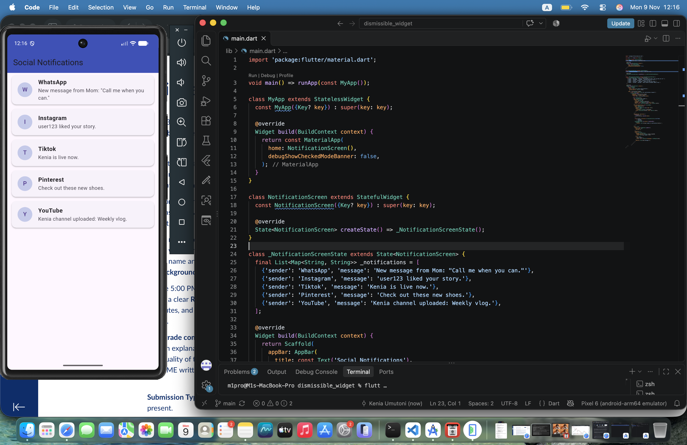

# Dismissible Widget

A simple Flutter application that demonstrates how to implement a swipe-to-dismiss notification list using the 'Dismissible' widget.

## Getting Started

Follow these steps to run the application on your local machine:

1. **Prerequisites:** Ensure you have Flutter and Dart installed on your system.
2. **Get Dependencies:** Navigate to the project folder and run:
   
   flutter pub get
   
3. **Run the Application:** Start your emulator or connect a device, then run:
   
   flutter run

## Key Attributes & Properties Used

The application utilizes a 'Dismissible' widget configured with the following main features:

* **Background Elements ( 'background' & 'secondaryBackground'):** Displays a red background with a delete icon when swiping from left to right (Start to End), and a green background with an archive icon when swiping from right to left (End to Start).
* **Unique Keys ('key'):** Employs a custom 'ValueKey(item['sender'])' to help Flutter uniquely identify and manage the state of each swipeable list item safely.
* **Dismiss Direction Events (onDismissed):** Triggers state updates using '_notifications.removeAt(index)' and presents contextual actions via a 'SnackBar' specifying whether a notification was successfully "deleted" or "archived".

## Application UI

Below is a preview of the final social notification screen layout running on an Android Emulator:

